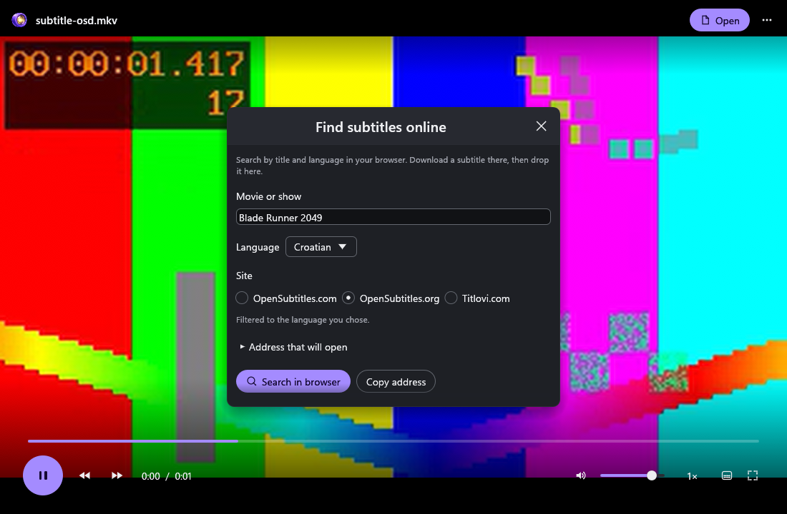

# Vesper

## A native video player for Windows

Open local video with responsive loading, 4K decoding and practical subtitle controls.

[Vesper downloads](https://github.com/v2matosevic/Vesper/releases/latest) � [Install](docs/INSTALL.md)
� [User guide](docs/USER-GUIDE.md) � [Formats](docs/FORMATS.md)
� [Build](docs/BUILD.md) � [Verification](docs/VERIFICATION.md)

## Features

- Representative MP4/MOV, MKV, AVI, WebM, TS/M2TS, MPEG, FLV, WMV, OGV and 3GP playback.
- H.264, HEVC, HEVC 10-bit, VP9 and AV1 4K profiles checked on generated samples.
- Embedded/local SRT, ASS/SSA and VTT, subtitle encoding and delay controls.
- Audio/subtitle tracks, speed, frame stepping, resume and optional subtitle search in your browser.

## Requirements

Windows 10/11 x64 and an OpenGL-capable graphics driver. Development verification used Windows 11.
Download Vesper-0.2.1-Setup.exe or its portable ZIP. Installation is per-user and needs no admin
account. No accounts, Electron, telemetry or background service. Installers preserve default apps.
Builds are currently unsigned; checksum and update instructions are in the installation guide.

## License and contributing

First-party code and original artwork are MIT licensed. The complete Windows distribution includes GPL components and is distributed under GPL-3.0-or-later. Exact corresponding source and notices accompany every release. [License](LICENSE) � [Third-party terms](docs/LICENSING.md).
This is an independent app and repository. Its shared UI source is included locally, so building
or using Vesper does not require another app repository. Publisher: Version2.
[Contributing](CONTRIBUTING.md) � [Security](SECURITY.md).

The screenshot is actual application UI with generated demonstration media. See verification for
the checks performed and remaining hardware, physical-input and perceptual limits.
