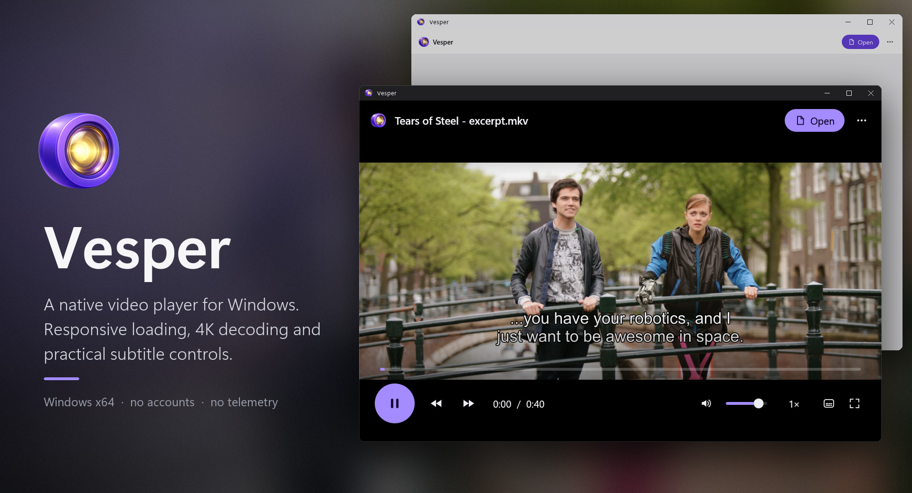
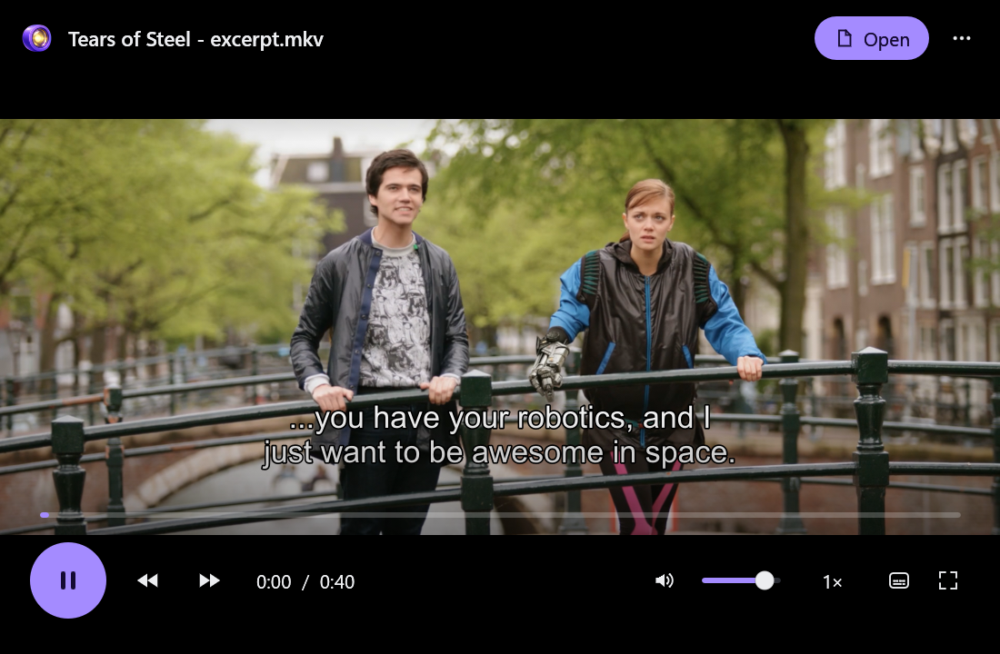
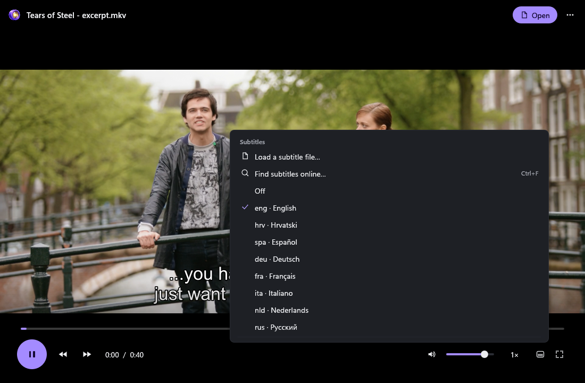
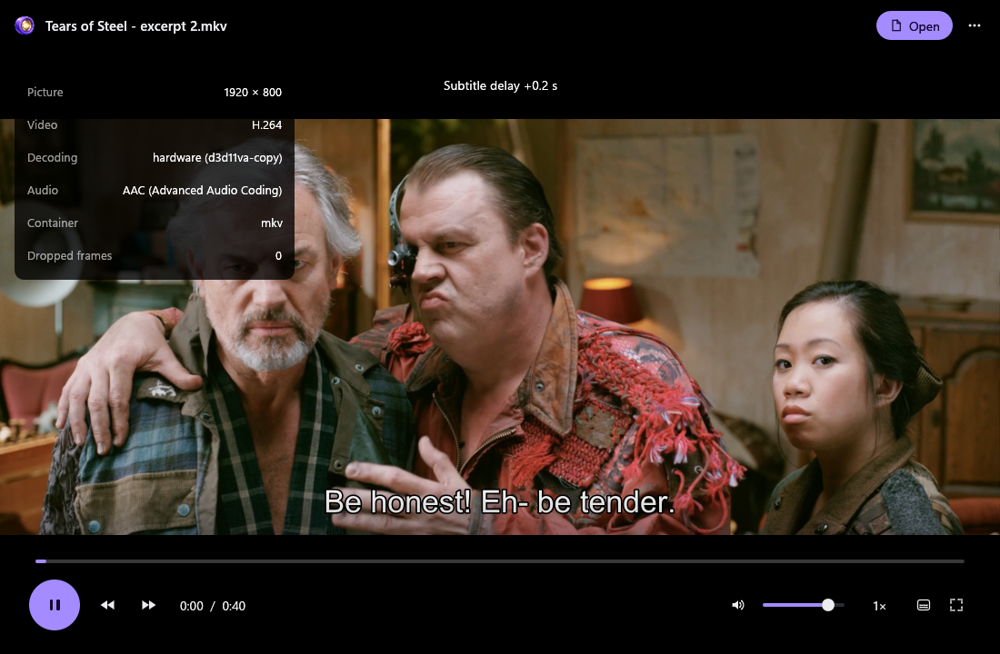
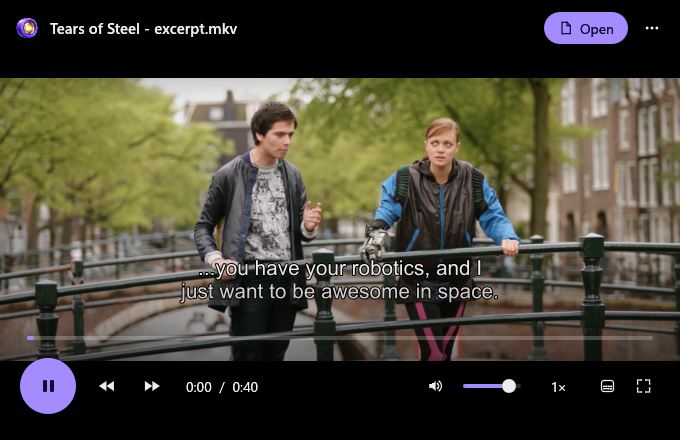
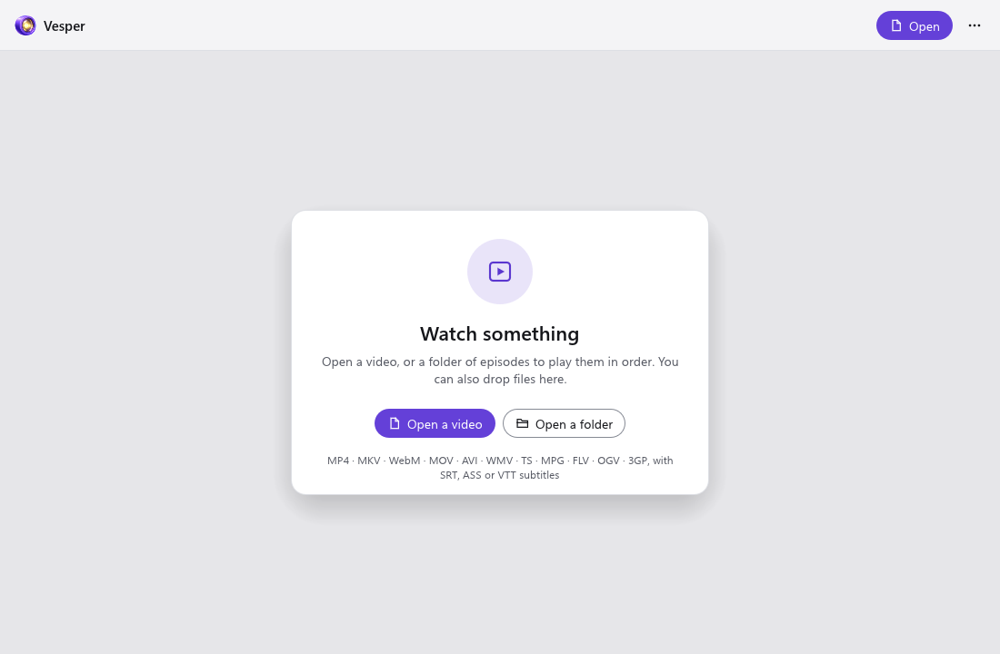

  

Vesper is a native video player for Windows. It opens local video quickly, decodes 4K, and keeps
subtitles practical: embedded or local files, a choice of text encoding, delay controls, and a
browser search that only runs when you click it. No account, no telemetry, no background service.

**[Download Vesper 0.2.1](https://github.com/v2matosevic/Vesper/releases/latest)** (installer 56.5 MB)
· [Install](docs/INSTALL.md) · [User guide](docs/USER-GUIDE.md) · [Formats](docs/FORMATS.md)
· [Build](docs/BUILD.md) · [Verification](docs/VERIFICATION.md)

The picture above is a mockup built from real captures. Every picture, and the film behind it,
is explained in [docs/MEDIA-CREDITS.md](docs/MEDIA-CREDITS.md).

## What it does

- Plays local MP4/MOV, MKV, AVI, WebM, TS/M2TS, MPEG, FLV, WMV, OGV and 3GP files.
- Decodes H.264, HEVC (also 10-bit), VP9 and AV1, with 4K profiles checked on generated samples.
- Reads embedded and local SRT, ASS/SSA and VTT subtitles, with text encoding and delay controls.
- Lists audio and subtitle tracks, changes speed, steps frames and remembers where you stopped.
- Opens a subtitle search in your browser only after you ask for it, and never uploads your file path.

## Install in a minute

1. Download `Vesper-0.2.1-Setup.exe` from the [latest release](https://github.com/v2matosevic/Vesper/releases/latest).
2. Run it. Vesper installs for your user only, needs no administrator account and appears in Start under Version2.
3. Open a video from the app, or drag one onto the window. The Open with option is off unless you tick it.

Prefer no installer? Download the portable ZIP (79.1 MB), extract every file into a fresh folder and
run `vesper.exe`. The builds are unsigned, so compare the download with `SHA256SUMS.txt` first:
`Get-FileHash -Algorithm SHA256 <file>`. More in the [installation guide](docs/INSTALL.md).
The release also holds `Vesper-0.2.1-decoder-source.zip` (1.4 GB): the exact source of the bundled
decoder, required for the GPL, for developers only. You do not need it to run Vesper.

Windows 10 or 11 on x64 with an OpenGL-capable graphics driver. Development verification used Windows 11.

## A look inside

These are captures of the installed Vesper 0.2.1 itself, made with its own capture mode: it opens a
file in a hidden native OpenGL window, lets the decoder and the interface draw, and reads the pixels
back. The film is a 40 second excerpt of *Tears of Steel* (CC BY 3.0, Blender Foundation) with the
film's official subtitles. The captures are of a paused first frame, so the clock reads 0:00.
Credits and licenses are in [docs/MEDIA-CREDITS.md](docs/MEDIA-CREDITS.md).

The player: the picture, the subtitle line, a seek bar, transport, volume, speed and full screen.

The subtitle menu lists the tracks found in the file (here English, Croatian, Spanish, German,
French, Italian, Dutch and Russian), or loads a file, or opens the browser search. The menu is opened
by the capture mode.

The information panel (key `I`) shows what is really playing: picture size, codec, hardware decoding
(Direct3D 11 on this PC), audio codec, container and dropped frames. The "Subtitle delay" notice in
this capture is text staged by the capture mode.

A small window keeps the main controls: transport, seek bar, volume, speed, subtitles and full screen.

The start screen, in the light theme: open a video, or a folder of episodes to play in order. Dark,
light and follow-Windows themes are in the More menu.

## Formats and limits

Representative MP4/MOV, MKV, AVI, WebM, TS/M2TS, MPEG, FLV, WMV, OGV and 3GP files play, with
H.264, HEVC, VP9 and AV1. Support depends on the profile and your hardware, the display framebuffer
is capped at 4K, and there is no HDR display guarantee. Vesper accepts local files; network paths and
URLs are restricted. Details are in [docs/FORMATS.md](docs/FORMATS.md). What was checked, and what was
not (long films, audio/video sync over time, physical input, other graphics hardware), is in
[docs/VERIFICATION.md](docs/VERIFICATION.md).

## License and contributing

First-party code and original artwork are MIT licensed. The complete Windows distribution includes GPL
components (mpv and FFmpeg) and is distributed under GPL-3.0-or-later, with the exact corresponding
source and notices attached to every release ([License](LICENSE), [third-party terms](docs/LICENSING.md)).
The film used in the README keeps its own CC BY 3.0 terms ([media credits](docs/MEDIA-CREDITS.md)).
Vesper is an independent app and repository: its shared interface source is included here, so building
it needs no other repository. Publisher: Version2. [Contributing](CONTRIBUTING.md) · [Security](SECURITY.md).
